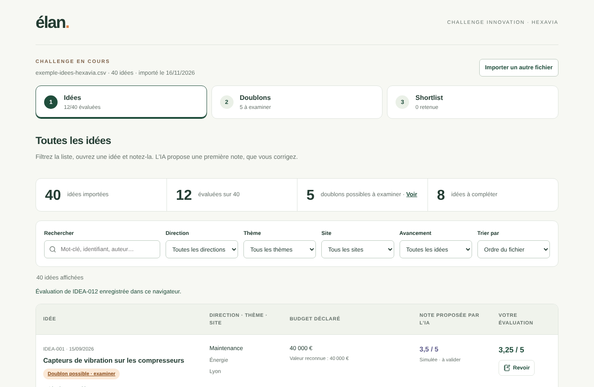
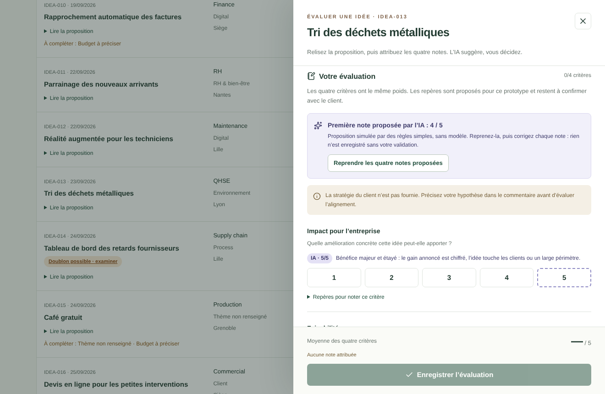
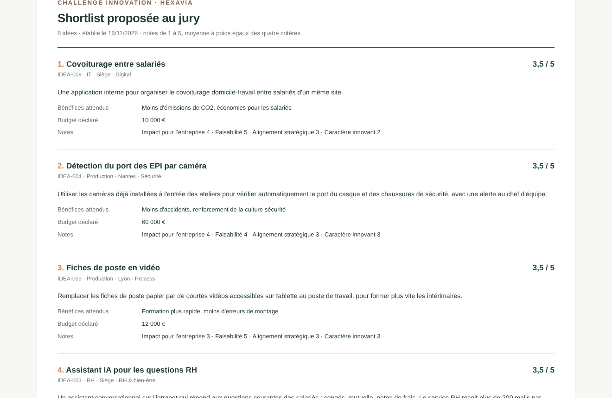

# Élan — dépouiller un challenge innovation

## Aperçu

**Application en ligne (Vercel) :** `Lien à ajouter après le déploiement`

| Les idées, filtrables | L'IA propose, la consultante corrige | Le document pour le jury |
| --- | --- | --- |
|  |  |  |

Captures prises en local sur le fichier d'exemple.

## Lancer l'outil

Prérequis : Node.js 22.12 ou supérieur.

```sh
git clone https://github.com/firasayadi444/Hexavia-rendu.git
cd Hexavia-rendu
npm ci
npm run dev
```

Ouvrir http://localhost:3000 et cliquer sur **Essayer avec l'exemple Hexavia** (ou importer `public/exemple-idees-hexavia.csv`). Aucune variable d'environnement n'est nécessaire. Vérifications : `npm run check`, `npm test`, `npm run build`.

## 1. Cadrage

**Le besoin.** Camille dépouille 40 idées à la main dans Excel, à dix jours du jury. C'est long et sa notation dérive d'une idée à l'autre. Il lui faut un seul endroit pour lire et filtrer les idées, les noter sur la grille du client avec une première proposition de l'IA, écarter les doublons et sortir une shortlist d'environ 8 idées à envoyer à Hexavia.

**Qui l'utilise.** Camille, consultante non technique, seule sur son poste. Le client et le jury ne voient que le document exporté.

**Mes hypothèses**

- Une seule consultante par challenge : pas de compte ni de base en V1, le travail reste dans son navigateur.
- Les quatre critères ont le même poids. Les repères 1/3/5 sont les miens, à faire valider par Hexavia.
- La stratégie d'Hexavia n'est pas fournie : l'IA propose 3 en alignement tant que les priorités ne sont pas configurées.
- « Un format que je peux envoyer » : un PDF lisible par le jury et un CSV qui s'ouvre dans Excel.
- Le nom des auteurs ne sort pas dans le document client, sauf si Camille coche la case.
- Un doublon n'est jamais supprimé ni fusionné par l'outil : Camille tranche, et peut revenir en arrière.
- Un budget illisible (`?`, vide) reste inconnu ; il n'est jamais remplacé par zéro.
- Les autres clients exportent les mêmes 11 colonnes.

| Dans la V1 | Attendra |
| --- | --- |
| Import du CSV avec contrôle des données | Comptes, base partagée, travail à plusieurs |
| Filtres, recherche, tris | Vrai modèle d'IA |
| Note proposée par une IA simulée, corrigeable | Correspondance de colonnes pour d'autres exports |
| Repérage des doublons, décision par Camille | Pondération des critères, grille par client |
| Shortlist, export PDF et CSV | Export Word ou PowerPoint à la charte du client |

## 2. Conception

**Architecture.** Une application Next.js. Le serveur lit le fichier et calcule les notes proposées, sans rien conserver. Le navigateur garde l'état de travail et fait le reste. Détail dans `docs/architecture.md`.

**Modèle de données** (`src/modules`)

- `Idea` : les champs de l'export, plus `budget` (montant reconnu ou `null`) et `warnings` (ce qui manque).
- `Proposal` : quatre notes, une justification par critère, des réserves, et `source: 'simulation'`.
- `Evaluation` : les quatre notes validées par Camille et son commentaire.
- `DuplicateDecision` : « deux idées distinctes » ou « X écartée comme doublon de Y ».
- `Workspace` : les idées, propositions, évaluations, décisions et la shortlist d'un fichier.

| Choix | Raison |
| --- | --- |
| Next.js, React, TypeScript | La stack d'INSKIP ; une seule application à déployer sur Vercel. |
| Action serveur pour l'import et l'IA | La clé du modèle reste côté serveur ; le fichier n'est jamais stocké. |
| `localStorage` plutôt qu'une base | Pas de compte, aucune donnée personnelle sur un serveur. Limite : un seul poste. |
| Règles métier hors de React | Elles se testent sans navigateur et survivront au passage à Supabase. |
| Zod | Le CSV, les notes et ce qui est relu du navigateur sont validés de la même façon. |
| IA et doublons par règles | Pas de clé dans l'exercice ; des règles lisibles se testent et s'expliquent à Camille. |
| Lecteur CSV écrit à la main | 11 colonnes connues, moins de 80 lignes de code, testé sur le vrai fichier. |

## 3. Construction avec l'IA

**Assistants.** Codex pour l'import et l'évaluation manuelle, Claude pour les filtres, l'IA simulée, les doublons, la shortlist et leurs tests. Leurs consignes sont dans `AGENTS.md` : une fonctionnalité à la fois, un test par règle, rien d'inventé.

**Prompts utilisés.** L’historique des échanges n’est pas archivé dans le dépôt. Les prompts réellement utilisés restent à renseigner par l’auteur à partir de ses propres notes ; ils ne sont pas reconstitués ici.

**Retour sur les erreurs de l’IA.** Le dépôt ne conserve pas d’historique permettant d’attribuer de façon fiable une erreur précise à un assistant. Pendant la préparation de cette version, le build a révélé un problème de route d’icône dans le chemin Windows contenant une apostrophe ; l’icône a été déplacée dans `public/` et le build a ensuite réussi.

## 4. Fiabilisation

61 tests sur la logique, lancés par `npm test`, la plupart sur le vrai export :

- **Import (15)** : 40 idées sans perte, budgets libres, dates impossibles, guillemets, colonnes, limites de taille.
- **Notation (6)** : quatre notes obligatoires, bornes, moyenne à poids égaux.
- **Doublons (8)** : les cinq paires attendues et aucune autre, doublon exact malgré la casse et les accents.
- **IA simulée (10)** : aucune donnée d'auteur transmise, notes toujours entre 1 et 5, clé lue par configuration.
- **Filtres (7)**, **shortlist et export (7)** : classement, auteurs masqués par défaut, formules neutralisées pour Excel.
- **Travail enregistré (8)** : relecture à l'identique, contenu abîmé ignoré.

La CI (`.github/workflows/ci.yml`) lance à chaque push et pull request : installation, types, tests, compilation.

Non couvert par les tests automatisés : les composants React. Une vérification manuelle dans Chrome est mentionnée dans l’historique du projet, mais elle n’a pas été rejouée lors de cette préparation. Le parcours clavier et lecteur d’écran reste à vérifier.

## 5. Livraison

**Configuration.** Tout est facultatif, voir `.env.example` : `AI_API_KEY` et `AI_MODEL` pour brancher un modèle, `STRATEGIC_PRIORITIES` pour l'alignement, `NEXT_PUBLIC_CLIENT_NAME` pour un autre client. Sur Vercel : importer le dépôt, aucun réglage requis.

**Données personnelles.** Le fichier est lu en mémoire puis oublié par le serveur, jamais journalisé. L'IA ne reçoit pas le nom des auteurs. Le travail reste dans le navigateur de Camille et s'efface avec « Importer un autre fichier ». Aucun secret dans le dépôt.

**Ce qui manque avant de le confier à Camille**

- La grille et les priorités stratégiques confirmées par Hexavia.
- Un vrai modèle : en V1, la clé est lue mais les notes restent simulées (`src/modules/ai/provider.ts`).
- Une sauvegarde hors du navigateur : vider le cache ou changer de poste fait perdre le travail.
- Un contrôle d'accès si de vraies données y passent.
- Une détection des doublons qui comprend le sens : aujourd'hui elle compare des mots.

## 6. Journal

Aucun relevé horaire fiable n’est joint au dépôt ; les heures ne sont pas reconstituées après coup. Ajouter ici le journal réel si ces horaires sont requis pour la remise.

## 7. Suite et questions pour Camille

**Avec une journée de plus**

1. Supabase et connexion, pour retrouver son travail partout et noter à plusieurs.
2. Un vrai modèle derrière `provider.ts`, la simulation restant en secours.
3. La saisie des priorités du client et de la pondération dans l'interface.
4. Un export à la charte du client.

**Mes questions**

- Hexavia a-t-il une grille officielle, avec des poids et des repères par note ?
- Quelles sont ses priorités stratégiques, pour noter l'alignement ?
- Quel format attend le client : PDF, Excel, diaporama ? Avec le nom des auteurs ?
- Notes-tu seule, ou faut-il harmoniser les notes de plusieurs consultants ?
- Pour deux idées proches : garder la première déposée, ou les présenter ensemble au jury ?
- La shortlist doit-elle être équilibrée entre directions ou sites ?
